<div align="center">


<p>
  <a href="https://tonytzan.github.io"></a>
  <a href="https://www.linkedin.com/in/tuantranmanh/"></a>
  <a href="https://twitter.com/tonytranyp"></a>
  <a href="mailto:manhtuan17121994@gmail.com"></a>
  <a href="https://tonytzan.github.io/docs/Tuan_Tran_Manh_CV.pdf"></a>
</p>

</div>

```bash
$ cat about.md
Senior Software Engineer (AI-Native). 9 years in mobile, now building
across the whole product — Flutter apps, Node.js/TypeScript services and
web — through a spec-driven agentic harness with a human gate at every
decision that matters. Based in Ho Chi Minh City, open to remote.

$ ls ~/roles
Senior Full Stack Engineer, AI-First  @ CleverCards    #1 Finance App, App Store Ireland
Senior Full Stack Engineer, AI-First  @ Arki Finance   MAS-licensed wealth app · consulting
Senior Full Stack Engineer, AI-First  @ Shipeace       AI logistics platform, $1.5M raised

$ echo $MOTTO
"Agents write the code. I own what ships."
```

### `~/metrics`

<table>
<tr>
<td align="center"><strong>🏆 #1</strong><br/><sub>Finance App<br/>App Store Ireland</sub></td>
<td align="center"><strong>💰 $1.5M</strong><br/><sub>VC raised<br/>with Shipeace</sub></td>
<td align="center"><strong>📱 9 yrs</strong><br/><sub>Shipping<br/>production apps</sub></td>
<td align="center"><strong>🛡️ 99%</strong><br/><sub>Crash-free<br/>on CleverCards</sub></td>
<td align="center"><strong>📈 +70%</strong><br/><sub>Active users on<br/>Shuei e-commerce app</sub></td>
</tr>
</table>

---

### `~/harness`

I run feature work through a team of Claude Code subagents — an advisor, an architect, builders and a reviewer, each pinned to the model and effort its job needs — driven by slash commands for every stage of a spec lifecycle. They draft, build and audit. I approve the brief, approve the spec and accept what ships.

<div align="center">



</div>

**200+** tests, run in CI on Linux, macOS & Windows · **3** review rounds at most per spec, then I decide · **4 · 17 · 5** agents, skills & hooks in one repo, identical on two machines

| | |
|---|---|
| 📐 specs are the contract | specs first, code second — agents implement against it, I review against it |
| 🧑‍⚖️ humans own the decisions | the reviewer never judges its own work, and acceptance stays mine: no merge, deploy or "Approved" without me |
| 🚀 guardrails that scale to teams | hooks that refuse writes to `.env` & `.git`, a spec-gate check, and a self-testing sync that rolls itself back — one repo, so a team can run the same workflow |

---

### `~/stack`

**agentic**


![Codex](https://img.shields.io/badge/Codex-23261F?style=flat-square&logo=data:image/svg+xml;base64,PHN2ZyB4bWxucz0iaHR0cDovL3d3dy53My5vcmcvMjAwMC9zdmciIHZpZXdCb3g9IjAgMCAyNCAyNCIgd2lkdGg9IjI0IiBoZWlnaHQ9IjI0Ij48cGF0aCBmaWxsPSIjQzhGMTY5IiBkPSJNMjAuNTYyIDEwLjE4OGMuMjUtLjY4OC4zMTMtMS4zNzYuMjUtMi4wNjNjLS4wNjItLjY4Ny0uMzEyLTEuMzc1LS42MjUtMmMtLjU2Mi0uOTM3LTEuMzc1LTEuNjg3LTIuMzEyLTIuMTI1Yy0xLS40MzctMi4wNjMtLjU2Mi0zLjEyNS0uMzEyYy0uNS0uNS0xLjA2My0uOTM4LTEuNjg4LTEuMjVTMTEuNjg3IDIgMTEgMmE1LjE3IDUuMTcgMCAwIDAtMyAuOTM4Yy0uODc1LjYyNC0xLjUgMS41LTEuODEzIDIuNWMtLjc1LjE4Ny0xLjM3NS41LTIgLjg3NWMtLjU2Mi40MzctMSAxLTEuMzc1IDEuNTYyYy0uNTYyLjkzOC0uNzUgMi0uNjI1IDMuMDYzYTUuNDQgNS40NCAwIDAgMCAxLjI1IDIuODc0YTQuNyA0LjcgMCAwIDAtLjI1IDIuMDYzYy4wNjMuNjg4LjMxMyAxLjM3NS42MjUgMmMuNTYzLjkzOCAxLjM3NSAxLjY4OCAyLjMxMyAyLjEyNWMxIC40MzggMi4wNjIuNTYzIDMuMTI1LjMxM2MuNS41IDEuMDYyLjkzNyAxLjY4NyAxLjI1UzEyLjMxMiAyMiAxMyAyMmE1LjE3IDUuMTcgMCAwIDAgMy0uOTM3Yy44NzUtLjYyNSAxLjUtMS41IDEuODEyLTIuNWE0LjU0IDQuNTQgMCAwIDAgMS45MzgtLjg3NWMuNTYyLS40MzggMS4wNjItLjkzOCAxLjM3NS0xLjU2M2MuNTYyLS45MzcuNzUtMiAuNjI1LTMuMDYyYy0uMTI1LTEuMDYzLS41LTIuMDYzLTEuMTg4LTIuODc2bS03LjUgMTAuNWMtMSAwLTEuNzUtLjMxMy0yLjQzNy0uODc1YzAgMCAuMDYyLS4wNjMuMTI1LS4wNjNsNC0yLjMxMmEuNS41IDAgMCAwIC4yNS0uMjVhLjU3LjU3IDAgMCAwIC4wNjItLjMxM1YxMS4yNWwxLjY4OCAxdjQuNjI1YTMuNjg1IDMuNjg1IDAgMCAxLTMuNjg4IDMuODEzTTUgMTcuMjVjLS40MzgtLjc1LS42MjUtMS42MjUtLjQzOC0yLjVjMCAwIC4wNjMuMDYzLjEyNS4wNjNsNCAyLjMxMmEuNTYuNTYgMCAwIDAgLjMxMy4wNjNjLjEyNSAwIC4yNSAwIC4zMTItLjA2M2w0Ljg3NS0yLjgxMnYxLjkzN2wtNC4wNjIgMi4zNzVBMy43IDMuNyAwIDAgMSA3LjMxMiAxOWMtMS0uMjUtMS44MTItLjg3NS0yLjMxMi0xLjc1TTMuOTM3IDguNTYzYTMuOCAzLjggMCAwIDEgMS45MzgtMS42MjZ2NC43NTFjMCAuMTI0IDAgLjI1LjA2Mi4zMTJhLjUuNSAwIDAgMCAuMjUuMjVsNC44NzUgMi44MTNsLTEuNjg3IDFsLTQtMi4zMTNhMy43IDMuNyAwIDAgMS0xLjc1LTIuMjVjLS4yNS0uOTM3LS4xODgtMi4wNjIuMzEyLTIuOTM3TTE3Ljc1IDExLjc1bC00Ljg3NS0yLjgxMmwxLjY4Ny0xbDQgMi4zMTJjLjYyNS4zNzUgMS4xMjUuODc1IDEuNDM4IDEuNXMuNSAxLjMxMy40MzcgMi4wNjNhMy43IDMuNyAwIDAgMS0uNzUgMS45MzdjLS40MzcuNTYzLTEgMS0xLjY4NyAxLjI1di00Ljc1YzAtLjEyNSAwLS4yNS0uMDYzLS4zMTJjMCAwLS4wNjItLjEyNi0uMTg3LS4xODhtMS42ODctMi41cy0uMDYyLS4wNjItLjEyNS0uMDYybC00LTIuMzEzYy0uMTI1LS4wNjItLjE4Ny0uMDYyLS4zMTItLjA2MnMtLjI1IDAtLjMxMy4wNjJMOS44MTIgOS42ODhWNy43NWw0LjA2My0yLjM3NWMuNjI1LS4zNzUgMS4zMTItLjUgMi4wNjItLjVjLjY4OCAwIDEuMzc1LjI1IDIgLjY4OGMuNTYzLjQzNyAxLjA2MyAxIDEuMzEzIDEuNjI1cy4zMTIgMS4zNzUuMTg3IDIuMDYybS0xMC41IDMuNWwtMS42ODctMVY3LjA2M2MwLS42ODguMTg3LTEuNDM4LjU2Mi0yQzguMTg3IDQuNDM4IDguNzUgNCA5LjM3NSAzLjY4OGEzLjM3IDMuMzcgMCAwIDEgMi4wNjItLjMxM2MuNjg4LjA2MyAxLjM3NS4zNzUgMS45MzguODEzYzAgMC0uMDYzLjA2Mi0uMTI1LjA2MmwtNCAyLjMxM2EuNS41IDAgMCAwLS4yNS4yNWMtLjA2My4xMjUtLjA2My4xODctLjA2My4zMTJ6bS44NzUtMkwxMiA5LjVsMi4xODcgMS4yNXYyLjVMMTIgMTQuNWwtMi4xODgtMS4yNXoiLz48L3N2Zz4%3D)

**mobile**


**backend**


**web & cloud**


---

### `~/projects`

<div align="center">

<table>
<tr>
<td align="center" valign="top">
<br/>
<strong>CleverCards</strong><br/>
<sub>#1 Finance App, Ireland<br/>99% crash-free · Stripe</sub><br/><br/>
<a href="https://apps.apple.com/us/app/clevercards/id1521860373">App&nbsp;Store</a> · <a href="https://play.google.com/store/apps/details?id=com.clevercards.clevercash">Google&nbsp;Play</a><br/><a href="https://www.clevercards.com/">Website</a>
</td>
<td align="center" valign="top">
<br/>
<strong>Shipeace</strong><br/>
<sub>AI logistics platform<br/>$1.5M raised</sub><br/><br/>
<a href="https://www.shipeace.com/en">Website</a> · <a href="https://play.google.com/store/apps/details?id=com.logipeace.shipeace_app">Google&nbsp;Play</a><br/>&nbsp;
</td>
<td align="center" valign="top">
<br/>
<strong>Arki Finance</strong><br/>
<sub>MAS-licensed wealth app<br/>frontend lead</sub><br/><br/>
<a href="https://apps.apple.com/sg/app/arki-finance/id6733229005">App&nbsp;Store</a> · <a href="https://play.google.com/store/apps/details?id=com.optimalvest&amp;hl=en">Google&nbsp;Play</a><br/><a href="https://www.arkifinance.com/">Website</a>
</td>
</tr>
</table>

</div>

---

### `~/stats`

<div align="center">


<picture>
  <source media="(prefers-color-scheme: dark)" srcset="https://raw.githubusercontent.com/tonytzan/tonytzan/output/snake-dark.svg" />
  
</picture>


</div>

---

```bash
$ echo "need a product shipped across mobile, web and backend? reach out any time"
```

<div align="center">


</div>
